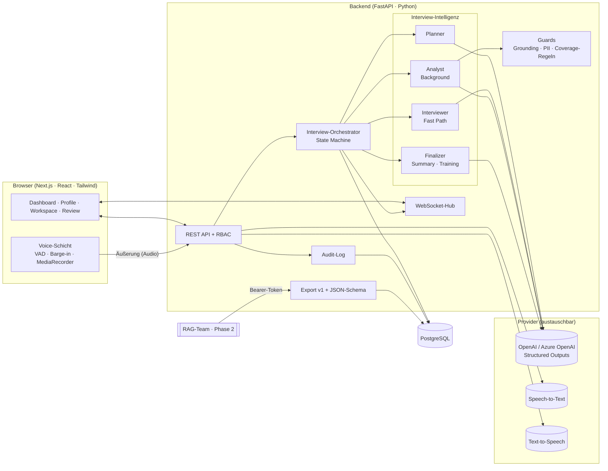
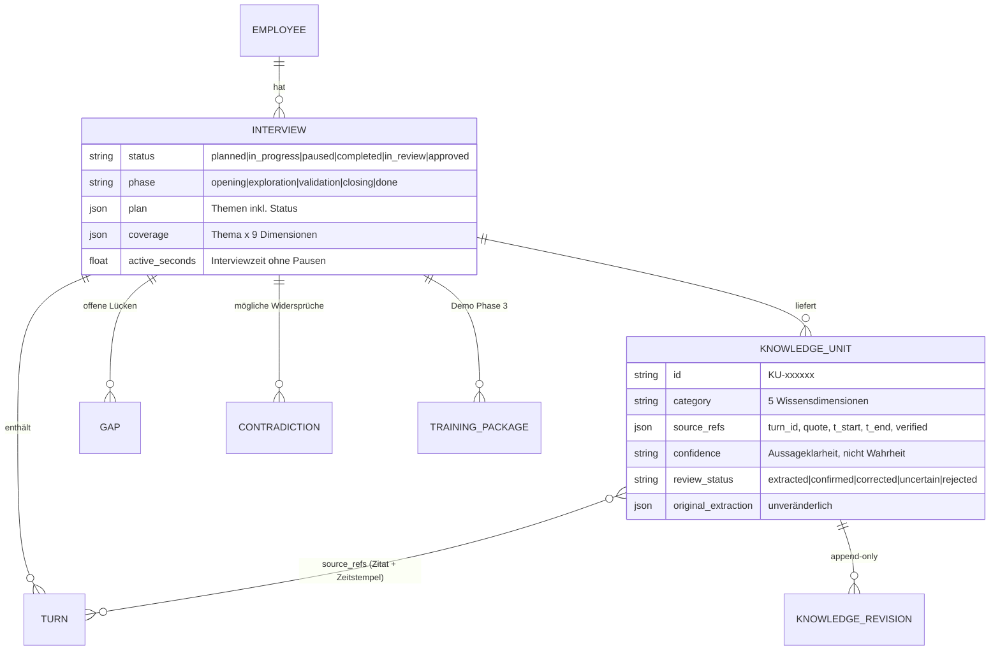
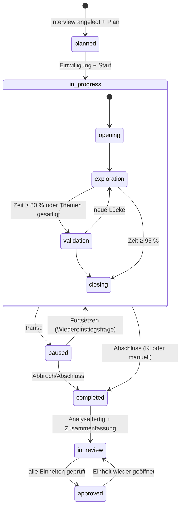
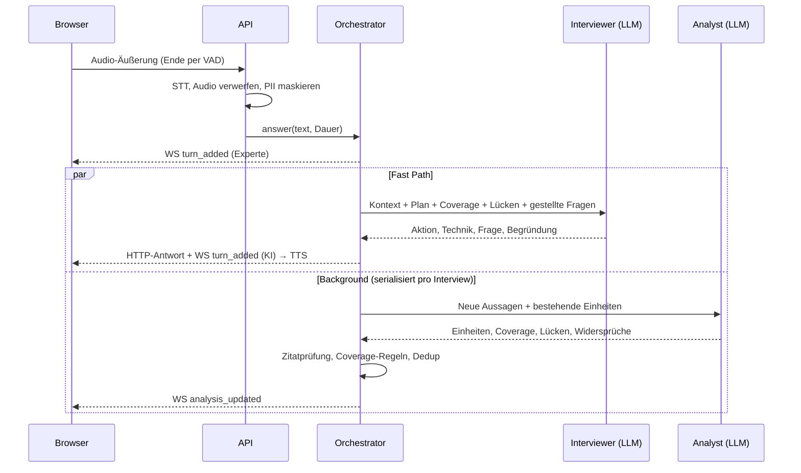

# 02 · Systemarchitektur

## Überblick

## Komponenten
| Komponente | Datei | Verantwortung |
|---|---|---|
| Config | `backend/app/config.py` | Alle Einstellungen per ENV |
| Datenmodell | `backend/app/models.py` | Employee, Interview, Turn, KnowledgeUnit, KnowledgeRevision, Gap, Contradiction, TrainingPackage, AuditLog |
| Provider | `backend/app/llm/provider.py` | `LLMProvider`/`SpeechProvider`-Protokolle, OpenAI + Azure |
| Intelligenz | `backend/app/agents/intelligence.py`, `schemas.py` | Prompts + strikte Ausgabeschemata |
| Orchestrator | `backend/app/services/orchestrator.py` | Zustandsautomat, Fast/Background-Pfade, Pause/Resume, Abschluss |
| Guards | `backend/app/services/guards.py`, `coverage.py` | Zitatprüfung, PII-Maskierung, Coverage-Regeln |
| Export | `backend/app/services/export.py` | Vertrag v1, Schema-Generierung |
| API | `backend/app/api/routes.py`, `deps.py` | REST, WebSocket, Rollen |
| Voice (Browser) | `frontend/lib/useVoice.ts` | VAD, Barge-in, Aufnahme, Wiedergabe |
| Realtime-Sync | `frontend/lib/useInterviewSocket.ts` | Heartbeat, Backoff, Resync |

## Datenmodell

## Interview State Machine

## Ablauf einer Antwort (Fast Path vs. Background)

## Voice-Architektur: Bewertung

| Kriterium | A) Realtime Voice-to-Voice | B) STT → LLM-Orchestrator → TTS **(gewählt)** |
|---|---|---|
| Latenz | ★★★ ~300–800 ms | ★★ ~2–4 s (STT + Fast-Path-LLM + TTS) |
| Gesprächsqualität | ★★★ sehr natürlich | ★★ natürlich, kleine Denkpause |
| Unterbrechbarkeit | ★★★ nativ | ★★ Barge-in per Browser-VAD |
| Transkriptqualität | ★★ Nebenprodukt, Zeitstempel unscharf | ★★★ eigenes STT mit Fachvokabular-Prompt, je Äußerung mit Zeitstempel |
| Kosten | ★ Audio-Tokens hin und zurück, Sitzung läuft durch | ★★★ Bezahlung nur pro Äußerung |
| Enterprise-Sicherheit | ★★ dauerhafter Audiostream zum Anbieter, weniger Kontrolle | ★★★ Audio nur pro Äußerung, sofort verworfen, PII-Maskierung *vor* dem LLM |
| Skalierbarkeit | ★★ zustandsbehaftete Sessions | ★★★ zustandslose Requests |
| Steuerbarkeit des Interviews | ★ das Modell führt das Gespräch und lässt sich schwer zu strikten Strukturen zwingen | ★★★ jede Frage ist eine geprüfte, strukturierte Entscheidung mit Technik und Begründung |

**Entscheidung: B.** Für Wissenssicherung im Bankumfeld sind Steuerbarkeit, Transkriptqualität und Datenschutz wichtiger
als die letzten paar hundert Millisekunden. Die Voice-Schicht ist austauschbar (`SpeechProvider`, `useVoice`):
Ein Realtime-Modell kann später als reine Audio-Ein-/Ausgabe eingesetzt werden, die Fragen trifft weiterhin der Orchestrator.

Umgesetzt: VAD mit adaptivem Rauschpegel, Barge-in (höhere Schwelle während TTS gegen Echo), konfigurierbare Pausentoleranz,
manuelles Beenden, Fehlerpfade (Mikro verweigert/getrennt, 422 „nichts erkannt“, 502 STT/LLM), Audio- und Transkriptstatus,
WebSocket-Reconnect mit Resync, Wiederaufnahme nach Pause.

## Sicherheitskonzept (MVP → Produktion)
| Thema | MVP (umgesetzt) | Produktion (Rollout) |
|---|---|---|
| Authentifizierung | Demo-Rollen per Header; Bearer-Token für RAG-Export (konstante Vergleichszeit) | Microsoft Entra ID (OIDC), Gruppen → Rollen, Managed Identity für Dienste |
| Autorisierung | Rollen admin / interviewer / expert / rag_consumer pro Endpoint; Review nur Experte/Admin; ungeprüfter Export nur Admin | zusätzlich Objektebene: Experte sieht nur eigene Interviews |
| Einwilligung | Information + Checkbox, versioniert, auditiert | Text vom DSB freigegeben; Widerruf mit Löschworkflow |
| Datenminimierung | Audio standardmäßig nicht gespeichert; PII-Maskierung (IBAN, E-Mail, Telefon, Vertragsnr.) vor Speicherung und LLM; Expertenname nicht im Export | NER-basierte Erkennung, Kundendaten-Blocklisten |
| Verschlüsselung | TLS am Ingress (Deployment) | TLS überall, Postgres-TDE/Disk-Verschlüsselung, Key Vault |
| Audit | Append-only Audit-Log für alle fachlichen Aktionen + Revisionshistorie je Einheit | SIEM-Anbindung, unveränderlicher Speicher |
| Aufbewahrung/Löschung | Kaskadierendes Löschen von Interview/Mitarbeiter (Admin, auditiert) | Fristen je Datenklasse, automatischer Purge-Job |
| LLM-Datenfluss | Konfigurierbar OpenAI oder **Azure OpenAI (EU-Region, keine Trainingsnutzung)** | Nur Helaba-KI-Plattform / Azure OpenAI, privater Endpunkt |
| Weitergabe | Export nur expertenbestätigter Einheiten | Freigabe-Workflow für sensible Themen |

## Technische Risiken
| Risiko | Gegenmaßnahme |
|---|---|
| LLM erfindet Fachinhalte | Prompt-Regeln, Pflichtzitat + deterministische Prüfung, Confidence ≠ Wahrheit, Mensch bestätigt |
| Latenz im Gespräch | Fast/Background-Split, schnelles Nicht-Reasoning-Modell für den Interviewer, kurze Fragen |
| STT-Fehler bei Fachbegriffen | Vokabular-Prompt (Bausparbegriffe) + aktuelle Frage als Kontext; Texteingabe als Fallback |
| Laute Umgebung (Pitch) | Adaptiver Rauschpegel, manuelles Beenden, Text-Fallback |
| Doppelte Wissenseinheiten | Analyst bekommt bestehende Einheiten und aktualisiert per ID; bestätigte Einheiten werden nie überschrieben |
| Anbieterbindung | Provider-Protokolle, Azure-Variante bereits enthalten |
