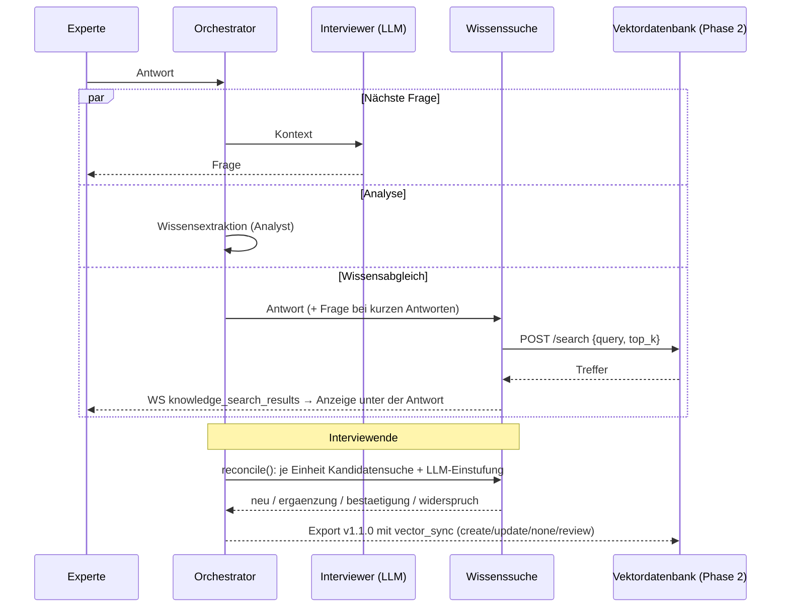

# 05 · Wissensabgleich mit der Vektordatenbank (Schnittstelle zu Phase 2)

## Wozu
Während der Experte antwortet, prüft die Plattform **parallel**, ob es zu seiner Aussage bereits Wissen gibt.
Am Interviewende wird jede Wissenseinheit eingestuft. Daraus folgt eine Empfehlung für die Vektordatenbank:

| Beziehung | Bedeutung | Empfehlung (`vector_sync.action`) |
|---|---|---|
| `neu` | Kein vergleichbarer Eintrag | `create`: neuen Eintrag anlegen |
| `ergaenzung` | Gleicher Sachverhalt, die Aussage bringt Details, Ausnahmen oder Praxis hinzu | `update`: `target_id` anpassen |
| `bestaetigung` | Inhaltlich bereits vorhanden | `none`: keine Änderung |
| `widerspruch` | Weicht inhaltlich von einem Eintrag ab | `review`: fachlich klären, nicht automatisch übernehmen |

Die Plattform beurteilt **nicht**, welche Seite fachlich richtig ist. Sie macht nur die Beziehung sichtbar. Die Vektordatenbank
selbst gehört zu Phase 2 und wird hier nicht gebaut.

## Ablauf

Ein Ausfall der Suche blockiert das Interview nie. Der Fehler wird angezeigt und der Abgleich am Ende erneut versucht.

## Provider (`KNOWLEDGE_SEARCH_PROVIDER`)
| Wert | Verhalten |
|---|---|
| `local` (Default) | Vektorsuche im Speicher, Embeddings über `EMBEDDING_MODEL`, Kosinus-Ähnlichkeit. Durchsucht `seed/reference_knowledge.json` (fiktiver Demo-Bestand) und bereits bestätigte Einheiten früherer Interviews. Ist das Embedding-Modell nicht erreichbar, wird 60 s lang lexikalisch gesucht und dann erneut versucht. **Platzhalter bis zur Anbindung.** |
| `http` | Search-Endpunkt der Vektordatenbank (siehe Vertrag unten) |
| `rag_service` | `GET {RAG_SERVICE_URL}/search` des externen RAG-Service (siehe „RAG-Service-Integration“ unten) |
| `off` | deaktiviert |

## Vertrag für den Search-Endpunkt der Vektordatenbank
**Anfrage**
```http
POST {VECTOR_SEARCH_URL}
Authorization: Bearer {VECTOR_SEARCH_API_KEY}   (optional)
Content-Type: application/json

{"query": "Wenn das Tarifkennzeichen fehlt, prüfe ich das Abschlussdatum …", "top_k": 3, "filters": {}}
```
`filters` kommt 1:1 aus `VECTOR_SEARCH_FILTERS` (JSON), z. B. `{"collection": "lbs-wissen"}`.

**Antwort (bevorzugt)**
```json
{"results": [
  {"id": "doc-123", "title": "Erkennung historischer Tarifgenerationen", "content": "Text des Chunks …",
   "score": 0.82, "source": "AA-B-12", "metadata": {"valid_from": "2019-01-01"}}
]}
```
Toleriert werden auch: Top-Level-Liste oder `hits` / `matches` / `documents` / `data`; Text in `text`, `chunk` oder
`page_content`; `similarity` statt `score`; `distance` (wird zu `1 - distance`); `title` und `source` aus `metadata`.
`score` sollte im Bereich 0–1 liegen, höher bedeutet ähnlicher.

**Anbinden, sobald der Endpunkt steht:**
```dotenv
KNOWLEDGE_SEARCH_PROVIDER=http
VECTOR_SEARCH_URL=https://<rag-service>/search
VECTOR_SEARCH_API_KEY=...
```

## RAG-Service-Integration (RAG service integration)
Optionaler externer RAG-Service (FastAPI, z. B. `http://localhost:8001`) mit zeitlich gültig geprüfter Wissensbasis.
Alles ist über `RAG_SERVICE_URL` geschaltet: **leer = aus, Verhalten unverändert.** Gesetzt:

1. **Fragevorschlag** – vor jeder Interviewer-Entscheidung ruft der Orchestrator `POST /interview/next`
   (Experte, Thema, bisherige Frage/Antwort-Paare mit `kb_verdict`). Vorschlag, Begründung und bis zu 6 Belege
   (Zitat, Gültigkeitsstatus) werden als Block `WISSENSBASIS` an den Interviewer-Kontext angehängt; die Entscheidung
   bleibt beim bestehenden Interviewer (Schema unverändert). Belege werden nur im Speicher gehalten (keine DB-Änderung).
2. **Fakt einreichen** – nach jeder Expertenantwort `POST /facts` (fire-and-forget); das zurückgegebene `kb_verdict`
   (correct / plausible / possibly_outdated / contradicted / unsupported / unchecked) fließt in den nächsten Aufruf ein.
3. **Suche** – mit `KNOWLEDGE_SEARCH_PROVIDER=rag_service` läuft die Live-Suche je Antwort und der Abgleich am Ende
   über `GET /search?q=…&k=…&as_of=<heute>`; Treffer tragen Zitat und Gültigkeitsstatus im Titel und in `metadata`.

Jeder Fehler des RAG-Service wird nur geloggt (`ekep.rag`), das Interview läuft ohne ihn weiter.
Timeouts: `/interview/next` 90 s, `/facts` 120 s, `/search` 20 s. Implementierung: `backend/app/services/rag_client.py`.

```dotenv
RAG_SERVICE_URL=http://localhost:8001
RAG_SERVICE_LANG=de                    # de | en
RAG_SERVICE_TOPIC=                     # leer = Interviewtitel
KNOWLEDGE_SEARCH_PROVIDER=rag_service  # optional, nur für die Suche
```
Erreichbarkeit prüfen:
```bash
curl -s http://localhost:8001/health
```

## API der Plattform
| Methode | Pfad | Zweck |
|---|---|---|
| GET | `/api/knowledge-search/status` | aktiver Provider |
| POST | `/api/knowledge-search` | Ad-hoc-Suche `{query}` (Test/Demo) |
| GET | `/api/interviews/{id}/knowledge-search` | alle Live-Suchen + Abgleichsergebnis |
| POST | `/api/interviews/{id}/reconcile` | Abgleich (erneut) ausführen |
| WS | `knowledge_search_started`, `knowledge_search_results`, `reconciliation_updated` | Live-Ereignisse |

## Export
Seit `ekep.knowledge-export` **1.1.0** (rückwärtskompatibel) enthält jede Einheit `vector_sync`:
```json
"vector_sync": {"relation": "ergaenzung", "action": "update", "target_id": "KB-0001",
                "target_title": "Erkennung historischer Tarifgenerationen", "similarity": 0.48,
                "explanation": "Ergänzt den Eintrag um die Prüfreihenfolge bei fehlendem Kennzeichen.", "method": "llm"}
```
